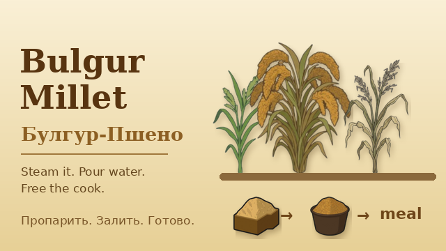

# Bulgur Millet | Булгур-Пшено

> **AI notice / Уведомление об ИИ:** this mod was made with AI. The images were generated with Gemini (Nano Banana); the code and texts were written with Gemini and Claude; edits and assembly by hand. / Мод сделан с помощью ИИ: картинки сгенерированы Gemini (Nano Banana), код и тексты писали Gemini и Claude, правки и сборка вручную.

**Provided as is, no support. Issues are disabled. / Мод "как есть", без поддержки. Issues отключены.**

## English

A small joke mod for **RimWorld 1.6** that adds one crop: **bulgur millet**, a genetically modified grain that is useless for bread and good only for steaming.

- Grows in 7 days and yields 10 grains (less than rice).
- Raw grains are inedible. Steam 10 grains into 1 **bulgur** (30% of a simple meal's work, x1 and x4 recipes).
- Bulgur never rots (keep it under a roof, rain still damages it), is edible as is with a small mood penalty ("half-raw groats", -4), and cannot cause food poisoning.
- Bulgur to a **simple meal** in 10% of the usual work (x1 and x4).
- Bulgur plus meat to a **lavish meal** in 30% of the usual work (x1 and x4, cooking skill 8).
- Recipes are added to every workstation that already has the vanilla simple meal recipe (campfire, stoves, and modded stoves too).
- Needs only the base game. No Harmony. Translations: English, Russian.

**Install:** download `BulgurMillet_1.0.zip` from Releases, unzip it into `RimWorld/Mods/`, enable the mod in the Mods menu. Adding it to an existing save should be fine, but I have not tested that. Removing it mid-save may cause errors.

## Русский

Небольшой шуточный мод для **RimWorld 1.6**, добавляет одну культуру: **булгур-пшено**, генномодифицированное зерно, которое не годится для хлеба, а только для пропаривания.

- Растёт 7 дней, даёт 10 зёрен (меньше, чем рис).
- Сырое зерно несъедобно. 10 зёрен пропариваются в 1 **булгур** (30% работы простого блюда, рецепты x1 и x4).
- Булгур не портится (хранить под крышей, дождь его всё равно портит), съедобен сразу с небольшим штрафом настроения («полусырая крупа», -4), отравиться им нельзя.
- Булгур в **простое блюдо** за 10% обычной работы (x1 и x4).
- Булгур с мясом в **шикарное блюдо** за 30% обычной работы (x1 и x4, навык готовки 8).
- Рецепты добавляются на все станции, где уже есть ванильное простое блюдо (костёр, плиты и модные плиты).
- Нужна только базовая игра. Harmony не нужен. Переводы: английский, русский.

**Установка:** скачайте `BulgurMillet_1.0.zip` из Releases, распакуйте в `RimWorld/Mods/`, включите мод в меню модов. В уже начатое сохранение добавить можно, но это не проверялось. Удаление посреди сохранения может вызвать ошибки.

## License / Лицензия

CC0 1.0: public domain. Copy, modify, put into modpacks, re-upload to the Steam Workshop (even under your own name). The author plays the GOG version and cannot publish to Steam. / CC0 1.0: общественное достояние. Копируйте, меняйте, кладите в сборки, выкладывайте в Steam Workshop хоть под своим именем. Автор играет на GOG-версии и сам в Steam выложить не может.
